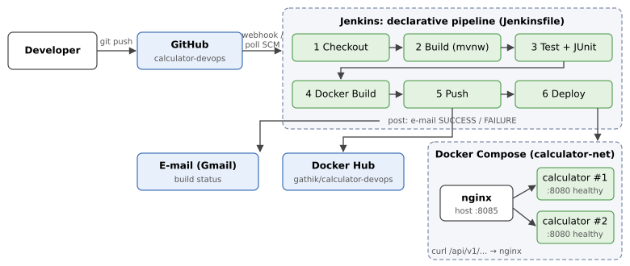
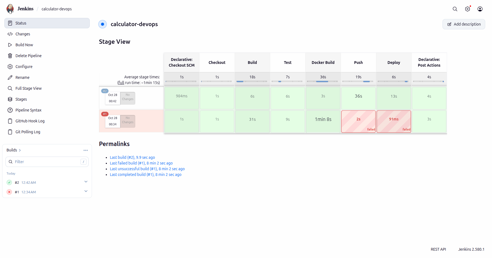
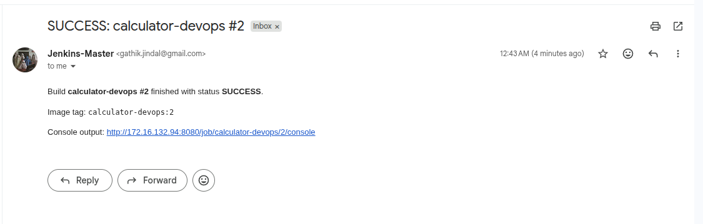
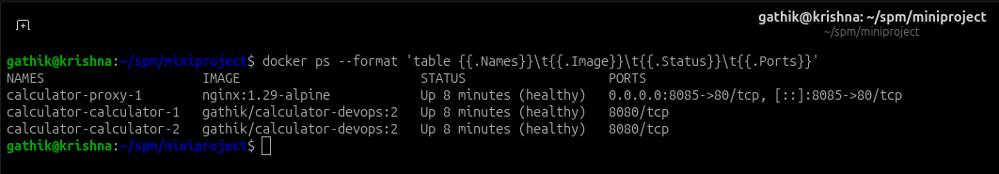
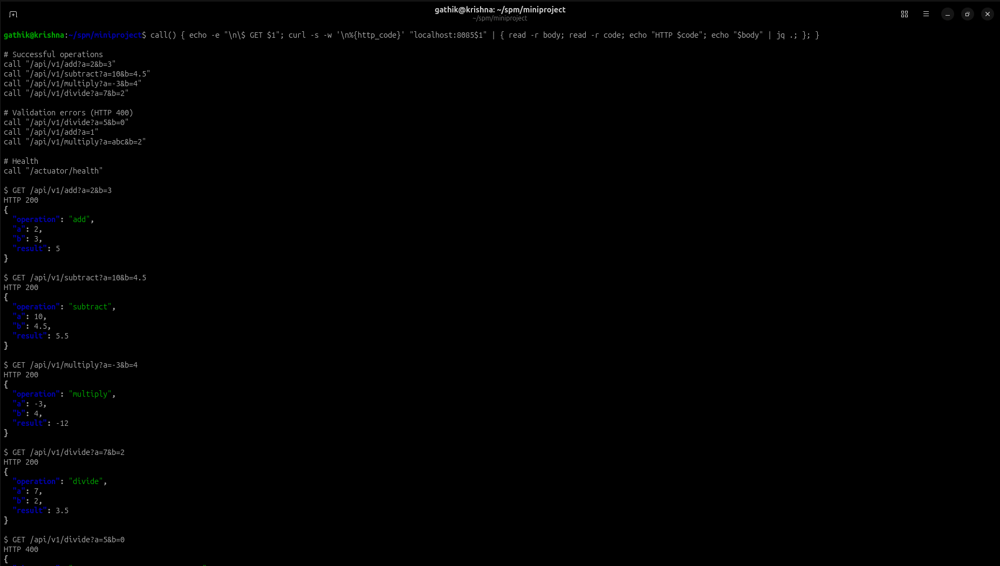
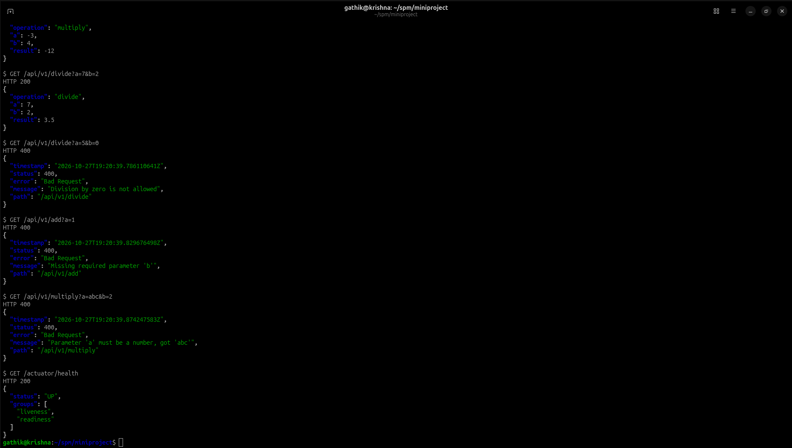
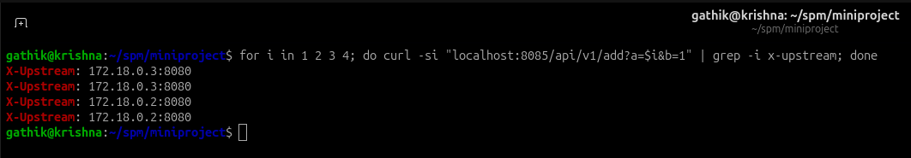

# CSE 816 Mini-Project: CI/CD Pipeline for a Calculator REST API

**Name:** Gathik Jindal · **Roll no.:** IMT2023089
**GitHub:** [Repo link](https://github.com/gathik-jindal/calculator-devops) · **Docker Hub:** [gathik/calculator-devops](https://hub.docker.com/r/gathik/calculator-devops)

## 1. Overview

The project is a Spring Boot 3.5 (Java 21, Maven) REST API that exposes add, subtract, multiply and divide
under `/api/v1`, plus an Actuator health endpoint. Each push to GitHub triggers a Jenkins declarative pipeline.
The pipeline builds and tests the code, packages it into a Docker image tagged with the Jenkins build number,
pushes the image to Docker Hub, and deploys it with Docker Compose behind an Nginx reverse proxy. Jenkins
e-mails the result of every build.

## 2. Architecture

## 3. Pipeline stages

| Stage | Description |
|---|---|
| Checkout | `checkout scm` fetches the commit that triggered the build. |
| Build | `./mvnw -B clean package -DskipTests` compiles the code and produces `target/calculator.jar`. The Maven wrapper pins Maven 3.9.11, so the agent needs no Maven install. |
| Test | `./mvnw -B test` runs 20 JUnit 5 unit tests and 8 MockMvc integration tests. The `junit` step publishes `target/surefire-reports/*.xml`, and a failing test makes Maven exit non-zero, which fails the build. |
| Docker Build | Multi-stage build. A Maven/JDK stage resolves dependencies in their own cached layer and then packages the JAR. A `21-jre-alpine` runtime stage runs the JAR as a non-root user, with `EXPOSE 8080` and a `HEALTHCHECK`. |
| Push | `docker login --password-stdin` uses the Jenkins credential `dockerhub-credentials`, so nothing is hard-coded. Both the build-number tag and `latest` are pushed. |
| Deploy | `docker compose up -d --wait --remove-orphans` with `IMAGE_TAG=$BUILD_NUMBER`. Compose waits for health checks to pass, then the pipeline curls `/actuator/health` through Nginx. |
| Notification | `emailext` in `post { always }` e-mails the build status and a console link. |

**Idempotency.** Compose only recreates containers whose image or config changed, so a re-run of the same
build leaves the running stack untouched. `disableConcurrentBuilds()` stops two deployments from overlapping.

**Compose design.** Two API replicas and an Nginx proxy share a bridge network. Nginx starts only after the
API is `service_healthy`. It resolves `calculator` through Docker's DNS at `127.0.0.11`, so it load-balances
across the replicas and keeps working after a redeploy changes container IPs. Every service has a health
check and `restart: unless-stopped`.

## 4. Challenges faced

- **No JDK on the build agent:** the machine had only a Java runtime, so `javac` was missing and the build
  failed with *"release version 21 not supported"*. Fix: install `openjdk-21-jdk-headless`.
- **Proxy health check reported unhealthy:** BusyBox `wget localhost` resolved to IPv6 `::1`, but Nginx listens
  on IPv4 only. Fix: probe `127.0.0.1` instead.
- **Nginx caching replica IPs:** a static `upstream` resolves the hostname once at startup and goes stale after a
  redeploy. Fix: a `resolver` directive plus a variable in `proxy_pass`, so Nginx re-resolves.
- **Exact decimal results:** with `double`, `0.1 + 0.2` gives `0.30000000000000004`. Fix: `BigDecimal` with
  `MathContext.DECIMAL64`, and Jackson set to write numbers as plain values (`100`, not `1E+2`).
- **Docker Hub login failed in Jenkins:** build #1 failed at Push with *"unauthorized: incorrect username or
  password"* because the Jenkins credential didn't match Docker Hub. Fix: generate a new Read & Write access
  token and re-enter the credential `dockerhub-credentials`. Build #2 then passed every stage.
- **Webhook reachability:** GitHub can't send webhooks to a Jenkins on a private network address, so the
  pipeline also uses Poll SCM (`H/2 * * * *`), which picks up pushes within about two minutes.

## 5. Screenshots

1. Green Jenkins pipeline run (Stage View): 
2. E-mail notification: 
3. `docker ps` showing proxy + 2 calculator containers (healthy): 
4. Sample API responses (success, divide-by-zero 400, health): 

